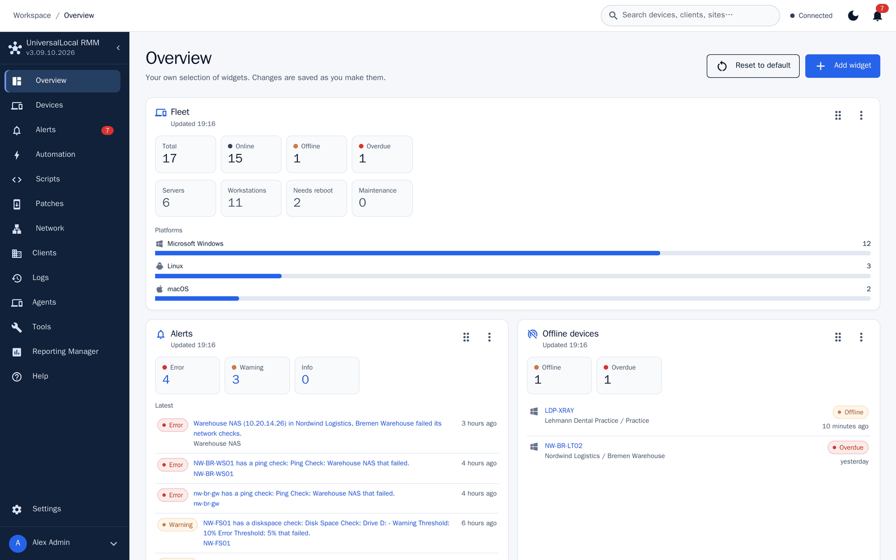
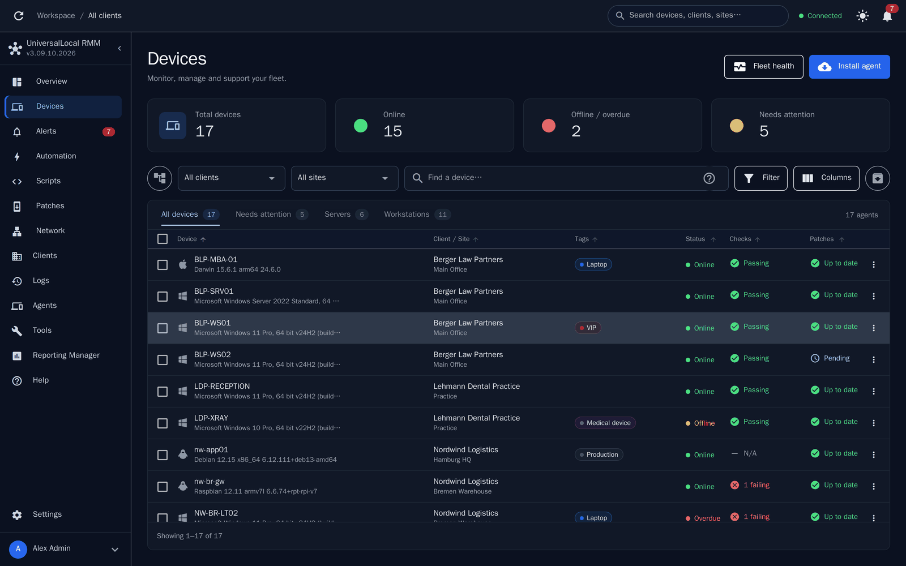
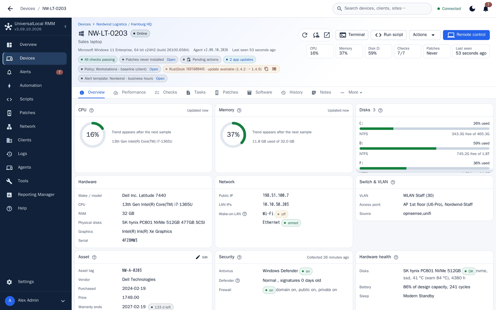
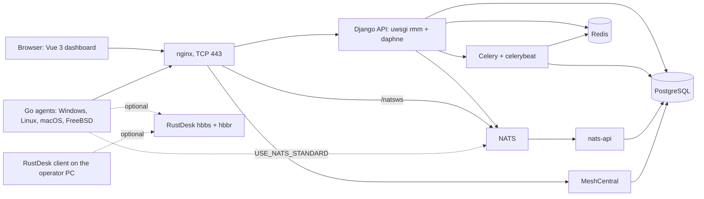

# UniversalLocal RMM

[](https://github.com/RiDDiX/ulrmm/actions/workflows/ci-tests.yml) [](https://github.com/RiDDiX/ulrmm/actions/workflows/release.yml) [](https://github.com/RiDDiX/ulrmm/releases) [](LICENSE.md) [](SECURITY.md)

UniversalLocal RMM is self-hosted remote monitoring and management for Windows,
Linux, macOS and FreeBSD/TrueNAS endpoints. The server is a Django API with a
Vue 3 dashboard, the endpoints run a Go agent, and remote access goes through
[MeshCentral](https://github.com/Ylianst/MeshCentral), which the installer sets
up next to the RMM, and, optionally, a self-hosted
[RustDesk](https://github.com/rustdesk/rustdesk-server) server on the same
machine. Both are third-party projects under their own licenses, see
[Third-party software](#third-party-software).

This file is the installation and operations guide. The screenshot tour is in
[`docs/SHOWCASE.md`](docs/SHOWCASE.md), the release procedure in
[`docs/VERSIONING_AND_RELEASES.md`](docs/VERSIONING_AND_RELEASES.md).

## What it does

- Clients, sites and agents in one dashboard, with role-based access, SSO and
  mandatory two-factor login (TOTP).
- Remote desktop, terminal and file browser through MeshCentral, a native agent
  terminal, and RustDesk as a second remote desktop.
- Scripts (PowerShell, Batch, Python, Shell, Nushell, Deno), scheduled tasks and
  checks (disk, CPU, memory, ping, services, event log, scripts) with e-mail,
  SMS and webhook alerts.
- Patch management for Windows Update and the Linux/macOS package managers, with
  approval policies.
- Software and hardware inventory, Windows services, event log and registry.
- Sleep and Wake-on-LAN for single devices and in bulk, maintenance windows and
  sleep/wake schedules that wake devices, install approved updates and put
  them back to sleep.
- Endpoint health (antivirus, firewall, disks, battery, temperatures) and
  agentless monitoring of network devices (ping, TCP, SNMP, HTTP(S), DNS).
- Software packages: upload installers (.exe, .msi, .msix/.appx, .pkg, .deb,
  .rpm) and install them on one device or in bulk, on Windows as SYSTEM or as
  the logged-in user. Each file is checked against its SHA-256 and signature on
  the device before it runs.
- Reporting, branding (product name, logo, support URL) that also goes into the
  agents, and agents built and optionally signed on the server itself.

## Showcase

A feature tour with 51 screenshots is in [`docs/SHOWCASE.md`](docs/SHOWCASE.md),
also as PDF in [English](docs/UniversalLocal-RMM-Showcase-EN.pdf) and
[German](docs/UniversalLocal-RMM-Showcase-DE.pdf).







### Security Center and agent trust

- Every command to an agent is signed with the server's Ed25519 command key and
  encrypted with ChaCha20-Poly1305. The session key comes from an ephemeral
  X25519 exchange with HKDF; sessions re-key by time and by volume. The agent
  signs its handshake answer with its own Ed25519 identity key, and an unsigned
  command is refused and recorded as a security event.
- Agents hold a client certificate from the server's own CA (mTLS). nginx checks
  it and passes the fingerprint to the API. Agents pin the server by SPKI hash:
  a pin set carries a primary pin, up to 8 backup pins and the command keys,
  signed as a pin document. When the certificate chain has moved to a backup
  pin, an admin promotes it in the Security Center (two-factor step-up); when
  nothing matches, the agent fetches the signed pin document again and records
  `pin_mismatch` or `tls_failure`.
- Agents talk to the server over TLS 1.3 only, with the hybrid X25519MLKEM768
  key exchange preferred. nginx also accepts a restricted TLS 1.2 profile
  (ECDHE + AEAD suites only) for older browsers and PowerShell clients, and
  enables X25519MLKEM768 when OpenSSL 3.5 or newer is present.
- Rotation runs on its own: client certificates renew at a configurable share
  of their lifetime, refresh tokens rotate on every use, and a new command key
  is promoted after 24 hours or once every agent with a sec2 identity reports
  the pin document that lists it. Identity, token and session rotation can also
  be forced from the Security Center.
- Clone detection: a second use of a rotated refresh token is a `token_reuse`
  event with both source addresses; an identity key that belongs to another
  agent is an `identity_conflict`. With the policy's auto-quarantine on, the
  agent is quarantined at once. Quarantined or blocked identities are refused
  at refresh and recovery and can be released from the Security Center.
- Offline grace: an agent whose certificate or tokens expired within the
  policy's grace period (0-90 days) recovers with a signed CSR and a nonce and
  gets a new certificate and token family; the recovery is logged as
  `grace_recovery`.
- The Security Center at `/security` shows the trust matrix (fingerprint,
  expiry, status per agent), rotation policies per client or site, the security
  events feed (27 event kinds, from `cert_refused` to `update_reverted`) and
  emergency actions (quarantine, block, reset identity, rotate command key).
  Changing or promoting the pins agents trust needs a fresh two-factor code.
- Agent protection: the agent hashes its own executable at start and every six
  hours against a signed manifest the server publishes and reports
  `integrity_mismatch`; configuration changed outside the agent raises
  `config_tampered`; an uninstall code per agent and an optional tamper watch
  alert when an agent disappears without shutdown, update or uninstall.
- LAPS rotates local admin passwords on Windows, Linux and macOS on the
  policy's interval (default 30 days, or after a reveal) and stores them
  encrypted; the vault keeps credentials and documents the same way and
  decrypts only in the reveal view. BitLocker and FileVault
  volumes are inventoried with their recovery keys, kept apart from the volume
  rows; LUKS status is collected on Linux.

### Deployment builder and OS images

- Per-deployment agent installers built on request: Windows setup `.exe` and
  PowerShell bootstrap (amd64, i386); Linux `.deb`, `.rpm`, `.tar.gz` and a
  shell bootstrap with a detached Ed25519 signature (amd64, i386, arm64, armhf).
- Bootable ISOs: a base image from the image library is rewritten on the server
  with pycdlib, the answer file and the agent added. The El Torito boot catalog
  and, where the library can carry it, the hybrid MBR/GPT of the base image are
  kept. When the MBR cannot be carried over, the build result says so: boot the
  ISO as CD/DVD or virtual media, or write it to USB with Rufus or Ventoy. The
  EFI boot entry of Windows media is widened to the size the FAT boot sector
  declares, so the rewritten ISO still boots on UEFI.
- Seed ISOs are a small second drive next to the unchanged install media, with
  the label the installer looks for: `AUTOUNATTEND` (Windows), `CIDATA` (Ubuntu
  autoinstall), `OEMDRV` (Kickstart, AutoYaST, Agama), `PRESEED` (Debian) and
  `ARCHINSTALL` (Arch, CachyOS, EndeavourOS). Every built image carries
  `/ulrmm/config.jws`: organisation, site, policy, enrollment token and
  certificate pins, signed with the server's Ed25519 key.
- Windows targets: Windows 10 (22H2) and Windows 11 (23H2, 24H2, 25H2, 26H2) as
  Home, Pro, Pro for IoT, Enterprise and IoT Enterprise, the latter also as
  LTSC 2021 (Windows 10) and LTSC 2024 (Windows 11); Windows Server 2019, 2022
  and 2025 as Standard and Datacenter, Core and Desktop Experience.
- Linux targets: Ubuntu 22.04 LTS, 24.04 LTS, 26.04 LTS and 26.10
  (autoinstall); Debian 12 and 13 (preseed); RHEL 9/10, Rocky Linux 9/10,
  AlmaLinux 9/10 and Fedora (Kickstart); SUSE Linux Enterprise 15 and openSUSE
  Leap 15 (AutoYaST); SLE 16 and Leap 16 (Agama); Arch Linux, CachyOS and
  EndeavourOS (archinstall); Batocera (experimental, answer files only). Arch
  family full ISOs do not autostart: the user copies three files from
  `/run/archiso/bootmnt` and runs `run-archinstall.sh`.
- Windows privacy as a preset (Windows defaults, Reduced, Maximum) plus one
  switch per control: advertising ID, tailored experiences, activity history,
  location, the Windows assistant, Recall, Spotlight, consumer content, web search, widgets,
  feedback, OneDrive, Edge diagnostics, inking and typing, speech, suggestions,
  error reporting, Cortana, Find My Device, tips, telemetry tasks and peer
  update sharing. Switches an edition does not honour are gated. Baselines add
  hardening policies (disk, BitLocker/LUKS, firewall, RDP/SSH, LAPS admin,
  debloat, telemetry) and software baselines per policy or deployment.
- First boot waits for the network before enrollment: Linux waits up to ten
  minutes for name resolution and a TCP connection to the server and restarts
  the oneshot unit every 10 s on failure; Windows waits up to five minutes
  before every install try and retries the first-boot task every 15 minutes
  until the agent has checked in.
- Base images come from pinned official download links (Ubuntu, Debian,
  Fedora, Rocky, AlmaLinux, openSUSE Leap, Arch, CachyOS, EndeavourOS,
  Batocera) through a download manager with progress, speed and ETA, resume,
  cancel and retry; a file is released only after its SHA-256 matches the
  distribution's sums file or a hand-entered checksum. Downloads are https only
  and must resolve to a public address across redirects.
- The image library at `/images` keeps base images and built ISOs as rows
  (label, OS family, BIOS, EFI, UDF, isohybrid and MBR presence recorded).
  Base images can be uploaded in chunks (14 GiB cap, two-factor step-up), built
  images are never offered as a base, downloads go through a link valid for
  ten minutes served by nginx, and stale upload parts are pruned after 24 hours.
- Operating system licenses stay with you: Windows, Windows Server, RHEL and
  SUSE Linux Enterprise need valid licenses or subscriptions, and built images
  are meant for your own deployments. When you give built images to others, the
  licenses of the systems inside apply, including the source code duties of
  the GPL for Linux media.

### Update Center

- The Update Center at `/updates` shows the server release state, the release
  sources and an agent fleet card.
- Release sources are GitHub, the developer's Gitea once
  `ULRMM_RELEASE_GITEA_TOKEN` is set, plus repositories you add in the
  dashboard (GitHub or Gitea/Forgejo URL, optional token stored encrypted). All
  sources are asked at once; for the latest release the newest version across
  all sources wins and GitHub only wins a tie. A pinned version comes from the
  first source in order that has it. A source that has not answered within 40
  seconds counts as down for that check. A sponsors-only alpha repository is
  the documented example of an added source.
- Every release manifest is checked against the Ed25519 key built into the
  server, every tarball against the manifest's sha256 and size while it
  streams. The updater has no option to skip either check; a release that does
  not verify is deleted and not installed, whatever source it came from.
- Before the swap, `update.sh` copies the running tree, dashboard and nats-api
  aside. After the services start it polls `core/health/` for about two
  minutes; if the new version does not answer, it goes back to the previous
  tree, dashboard and nats-api and exits with 1. The database keeps the new
  migrations; the pre-update backup is the way back to the old database.
- The dashboard shows a live stepper: preflight, download (with percent),
  verify (Ed25519 + SHA-256), backup, apply, migration, restart, health, and
  "Update failed, rolling back." when the rollback runs.
- Agents take only https downloads with a valid sha256 and a server signature
  over URL, version and hash, and refuse downgrades. On Linux, macOS and
  FreeBSD the downloaded binary runs a selftest (config, TLS 1.3 handshake with
  pinned trust and client certificate, `core/health/`) before it replaces the
  running one, and the service reverts to the previous binary when NATS is not
  reached within ten minutes of service start (`update_reverted` event). On
  Windows the signed installer replaces the files; there is no revert.
- Fleet rollout: "Update outdated agents" in the fleet card sends the update
  to every agent below `LATEST_AGENT_VER`.
- `ULRMM_UPDATER_HOOK` lets an executable apply the update instead of
  `update.sh`, for container setups; `update.sh --release [VERSION]` installs a
  signed release from the command line. Both are described under
  [Updating](#updating).

### Everything else

| Area | What it does |
|---|---|
| Sign-in and 2FA | Local accounts sign in with password plus TOTP code; OpenID Connect single sign-on is available as well. ([login](docs/showcase/login.png), [2FA](docs/showcase/login-2fa.png)) |
| Overview board | Each user builds a personal board from 14 widget types, saved per user, with one-click restore of the default board. ([screenshot](docs/showcase/overview.png)) |
| Devices workspace | One table for every client and site with status, checks, patch state and tags, plus fleet health, a quick panel and a right-click action menu. ([table](docs/showcase/devices.png), [fleet health](docs/showcase/devices-fleet-health.png), [quick panel](docs/showcase/devices-quick-panel.png), [action menu](docs/showcase/devices-action-menu.png)) |
| Device page | Double-click opens a page with 16 tabs: summary, checks, tasks, patches, software, apps, drivers, encryption, vault, vulnerabilities, assets, history, timeline, performance, audit, notes, debug. ([Windows](docs/showcase/device-overview-windows.png), [macOS](docs/showcase/device-overview-macos.png), [Linux](docs/showcase/device-overview-linux.png)) |
| Remote access | Take control through MeshCentral, VNC or RustDesk, or work in the background with a web terminal, process manager, services, event/system logs and registry editor. ([terminal](docs/showcase/remote-terminal.png), [processes](docs/showcase/remote-processes.png), [services](docs/showcase/remote-services.png), [logs](docs/showcase/remote-logs.png)) |
| Scripts and script library | 216 ready-made scripts (109 Windows, 74 Linux, 33 macOS) plus own scripts with a Monaco editor, typed variables, snippets and test runs, on one device or in bulk. ([manager](docs/showcase/script-manager.png), [run](docs/showcase/run-script.png), [bulk](docs/showcase/bulk-script.png)) |
| Checks, tasks and policies | Checks watch CPU, memory, disk, ping, script, service, event log, systemd, container and metric; tasks act on schedules or failures; automation policies roll both out to clients or sites. ([checks](docs/showcase/device-checks.png), [tasks](docs/showcase/device-tasks.png), [automation](docs/showcase/automation-manager.png)) |
| Alerts and notifications | Alert templates and exclusions collect what needs attention; notification channels and routes deliver it to the right target. ([alerts](docs/showcase/alerts-overview.png), [templates](docs/showcase/alert-templates.png), [notifications](docs/showcase/settings-notifications.png)) |
| Patch management and app updates | Windows Update with severity approvals and reboot rules; apt, dnf, yum, zypper, pacman, apk, flatpak, snap, Homebrew and softwareupdate; third-party app updates via winget, Homebrew and the Mac App Store; maintenance windows. ([Windows](docs/showcase/device-patches.png), [Linux](docs/showcase/device-patches-linux.png), [winget](docs/showcase/device-patches-winget.png), [macOS apps](docs/showcase/device-apps-macos.png), [settings](docs/showcase/settings-app-updates.png)) |
| Software inventory and packages | Installed software with uninstall; a package catalog rolls out own installers (exe, msi, archives with setup command, detection rules) with resumable chunked uploads and software baselines per policy or deployment. ([inventory](docs/showcase/device-software.png), [packages](docs/showcase/software-packages.png)) |
| Vulnerabilities | Linux packages matched against OSV.dev, missing Windows updates against Microsoft security data, Windows and macOS apps against the NVD; a fleet view and a per-device tab. ([fleet](docs/showcase/vulnerabilities.png), [device](docs/showcase/device-vulnerabilities.png)) |
| Encryption and vault | BitLocker recovery keys collected and stored, FileVault status with key rotation and escrow, LUKS status on Linux; a vault for credentials and documents per client, site or device behind a step-up. ([encryption](docs/showcase/device-encryption.png), [vault](docs/showcase/device-vault.png)) |
| LAPS | Local admin password rotation for Windows, Linux and macOS per site: account, length, interval, rotation after reveal; the password lives in the vault. ([screenshot](docs/showcase/settings-local-admin.png)) |
| Agent protection | Uninstall code per agent, optional tamper watch, watchdog that self-heals the binary. ([screenshot](docs/showcase/settings-agent-protection.png)) |
| Assets and licenses | Hardware assets per device and software licenses with what you own and have paid for; a stored Windows or volume-licensed Office key shows the devices that activated it and the free seats. ([screenshot](docs/showcase/settings-licenses.png)) |
| Network monitoring and discovery | Agentless monitoring from the server (ping, TCP ports, SNMP v2c/v3, HTTP(S) with certificate expiry, DNS; up to 256 devices) and subnet sweeps matched to agents or monitored devices. ([monitoring](docs/showcase/network-monitoring.png), [discovery](docs/showcase/network-discovery.png)) |
| Integrations | UniFi and OPNsense sync clients, VLANs, ARP tables, switch ports, access points and SSIDs. ([screenshot](docs/showcase/settings-network.png)) |
| Import from another RMM | Clients, sites, devices, custom fields, scripts, snippets and key store from a compatible RMM server or NinjaOne, previewed before anything is written; the installer goes to the devices through the old RMM ([Importing from another RMM](#importing-from-another-rmm)). |
| Performance history and timeline | CPU, memory and disk samples from 1 hour to 30 days; the timeline merges history, audit log, debug log, alerts, pending actions, patches, schedules and package installs; every command and script run is kept with its output. ([performance](docs/showcase/device-performance.png), [timeline](docs/showcase/device-timeline.png), [history](docs/showcase/device-history.png)) |
| Groups, tags and roles | Static and rule-based groups, tags and roles with fine-grained permissions; API keys and user sessions are managed too. ([groups](docs/showcase/device-groups.png), [roles](docs/showcase/roles.png)) |
| Reporting | Report templates in Markdown or HTML with data queries, on demand or on a schedule, previewed in a sandboxed frame. ([screenshot](docs/showcase/reporting.png)) |
| Branding and dark mode | Product name, company, support URL, logo and favicon on the sign-in page, header and agents; light or dark mode per user. ([branding](docs/showcase/settings-branding.png), [dark](docs/showcase/devices-dark.png)) |
| Keep-awake and power schedules | Dashboard keep-awake per device; maintenance windows that wake devices (WoL), install approved updates and put them back to sleep; sleep schedules after 15 minutes idle (servers never sleep). ([screenshot](docs/showcase/maintenance-power.png)) |
| Hardware health | Health cards on the device summary with sensor and health state per OS (firewall and WoL state included), system state, interfaces, containers and drivers. ([screenshot](docs/showcase/device-overview-linux.png)) |
| RustDesk | Self-hosted RustDesk server with optional automatic server and client updates, configured from Global Settings. ([screenshot](docs/showcase/settings-rustdesk.png)) |
| Agent builds | Agents built and optionally signed on the own server for Windows, macOS, Linux and FreeBSD (TrueNAS SCALE detected); installers per client/site deployment link. ([screenshot](docs/showcase/install-agent.png)) |
| About panel | Versions and changelogs of server, web and agent, parsed from each repository's `CHANGELOG.md`, and a link to GitHub Sponsors. |

### Two-factor step-up

Security-sensitive actions need a TOTP code even inside a logged-in session:

- **Deleting an agent, client or site** asks twice: the usual confirmation, then
  a dialog where you type the exact name and a fresh TOTP code. The code is
  checked by the server on every delete and never remembered. API keys need the
  key owner's current code in the request; users without TOTP (SSO users,
  service users) cannot delete.
- **Terminal and Files** (MeshCentral and the agent's own terminal) ask for a
  TOTP code once; it unlocks both for 60 minutes from that moment, not extended
  by use. Take Control (desktop) needs no code, except on a Linux device without
  a graphical session, where it opens the terminal and asks for the code.
  MeshCentral enforces this only while "Sync Mesh Perms with UniversalLocal RMM"
  in Global Settings -> MeshCentral is on (the default). With it off, the
  dashboard refuses the terminal and file grant, but every MeshCentral session,
  Take Control included, runs as the shared superuser with full terminal and
  file rights and no code. Keep the setting on.
- **Uploading or editing a software package** needs the same 60-minute unlock
  as Terminal and Files, because a package runs as SYSTEM or root.

## Architecture



- nginx terminates TLS on the API, dashboard and MeshCentral names. Agents reach
  the API and MeshCentral on TCP 443; port 80 only redirects. The NATS port is
  opened in the firewall only when `USE_NATS_STANDARD` is set.
- The Django API runs as the `rmm` (uwsgi) and `daphne` services; `celery` and
  `celerybeat` run the background jobs (agent self-update, command-key
  promotion, LAPS rotation, nightly pruning).
- PostgreSQL holds the RMM database and the MeshCentral database; Redis is the
  cache and broker with `requirepass` set by the installer.
- NATS carries the agent messages; `nats-api` is built from source on the server
  and uses the `ulrmm` database role.
- MeshCentral in `/meshcentral` gives remote desktop, terminal and file access.
  The RustDesk server (`rustdesk-hbbs`, `rustdesk-hbbr`) is optional and lives in
  `/opt/rustdesk`.
- Agents, nats-api and (unless a signed release is used) the dashboard are built
  on the server itself from the server, dashboard and agent repositories.

## Quickstart

On a fresh server, as the install user:

```bash
sudo apt install -y git
git clone https://github.com/RiDDiX/ulrmm.git
bash ulrmm/install.sh
```

The server needs a VM or physical host (no LXC) with Debian 12, Debian 13,
Ubuntu 22.04 or Ubuntu 24.04, x86_64 or aarch64, at least 4 GB of RAM, a normal
user with sudo, a UTF-8 locale, three DNS names under one root domain (API,
dashboard, MeshCentral) and a certificate (Let's Encrypt wildcard, your own, or
self-signed). The full list is under [Server requirements](#server-requirements),
every option under [Installation](#installation).

Then open `https://<frontend domain>` and log in with the user from the
installation ([First login](#first-login)), and install the first agent from
Agents -> **Install Agent** ([Adding agents](#adding-agents)).

The installer sets the services up on the host; the same stack as containers
is under [Docker Compose](#docker-compose). A container deployment of your own
can let the Update Center drive it through `ULRMM_UPDATER_HOOK`, described under
[Updates from signed releases](#updates-from-signed-releases).

## Docker Compose

`docker/compose.yml` runs the stack as containers: `nginx` (TLS, the
dashboard, the agent downloads), `api` (uwsgi), `ws` (uvicorn), `celery`,
`celerybeat`, `nats`, `natsapi`, `mesh` (MeshCentral), `db` (PostgreSQL 18)
and `redis`, plus the one-shot `init` that renders `local_settings.py` into
the `settings` volume and runs the migrations before the others start. The
images are published as `ghcr.io/riddix/ulrmm-api`, `ulrmm-natsapi`,
`ulrmm-nginx` and `ulrmm-mesh`, tagged with the version and `latest`. The
`nats` image tag and the MeshCentral version in `docker/mesh/Dockerfile` follow
`NATS_SERVER_VER` and `MESH_VER` in `api/ulrmm/ulrmm/settings.py` and move
with them.

Prerequisites: Docker Engine 29 or newer with Compose v2, the three DNS names
(API, dashboard, MeshCentral) under one root domain pointing at the host, and
a certificate for them. `ULRMM_TLS=own` mounts your `fullchain.pem` and
`privkey.pem`; `ULRMM_TLS=selfsigned` lets nginx create a wildcard
certificate for the root domain on the first start, as `install.sh --insecure`
does. The repositories `ulrmm-web`, `ulrmm-scripts` and `ulrmm-agent` must be
reachable from the host for `docker compose build`, the script library clone
in `init` and the agents job, either with access to the default URLs
(`ULRMM_WEB_TOKEN` and `ULRMM_SCRIPTS_TOKEN` in `.env`, `ULRMM_GIT_TOKEN` in
`local_settings.py` for the agents) or with `ULRMM_WEB_REPO`,
`ULRMM_SCRIPTS_REPO` and `ULRMM_AGENT_REPO` pointing at a reachable mirror.
Pulled images need none of that; a failed library clone only leaves a warning
in the `init` log.

```bash
git clone https://github.com/RiDDiX/ulrmm.git
cd ulrmm/docker
cp .env.example .env
# edit .env: names, passwords, ULRMM_TLS, ADMIN_PASSWORD
docker compose pull          # or: docker compose build
docker compose up -d
docker compose logs -f init  # ends with "[init] done"
```

With `ULRMM_TLS=own`, put the certificate next to the compose file and give
it to nginx, api and celery in a `compose.override.yml`:

```yaml
services:
  nginx:
    volumes:
      - ./certs:/certs
  api:
    volumes:
      - ./certs:/certs:ro
  celery:
    volumes:
      - ./certs:/certs:ro
```

Then open `https://<APP_DOMAIN>` and log in as `ADMIN_USER` with
`ADMIN_PASSWORD`; both are read on the first start only, and the account gets
its 2FA set up as under [First login](#first-login). The MeshCentral account
`MESH_USERNAME`/`MESH_PASSWORD` is created by the `mesh` container on its first
start.

Updating: set `ULRMM_VERSION` in `.env` to the new version, then
`docker compose pull` and `docker compose up -d`; `init` runs the migrations
and the other services wait for it. Back up before that: the database with
`docker compose exec db pg_dump -U ulrmm ulrmm | gzip > ulrmm.psql.gz` and
`docker compose exec db pg_dump -U meshcentral meshcentral | gzip > mesh.psql.gz`,
and the volumes `settings` (every key the server has, including the agent
token peppers and the field encryption keys), `agent-ca`, `mesh-data`,
`private` and `certs`, for example with
`docker run --rm -v ulrmm_settings:/v:ro -v "$PWD":/b alpine tar czf /b/settings.tgz -C /v .`
(the volume prefix is the compose project name, `docker volume ls` shows it).

Agents: `docker compose run --rm agents` builds the Linux, macOS and FreeBSD
agents into the `agents-dist` volume, which nginx serves under `/agentdist/`.
It needs the agent repository reachable (see above); the Go toolchain is
downloaded into that volume once and reused. Windows installers need Inno Setup and are not built in the container; build
them on a native install or with `riddix/agents/build_agents.sh` on a host
with `iscc`, and copy the files into the volume.

Differences from the native install: the Update Center's server update and the
server status panel do not work in containers (there is no `update.sh` run
and no systemd to ask; update by changing the image tag), the web terminal is
off (`ULRMM_DISABLE_WEB_TERMINAL`), the RustDesk server is not included, and
the nginx access log goes to the container log instead of
`private/log/access.log`.

## Repositories

Four repositories under `https://github.com/RiDDiX/<repo>`, branch `main` in
each; this is the default source of `install.sh` and `update.sh`. A second copy
of each lives on `git.riddix.de` (Gitea); `--source gitea` and `--git-url`
select it.

| Repository | Content |
|---|---|
| `RiDDiX/ulrmm` | server: API, nats-api, install/update/backup/restore scripts, agent build (this repository) |
| `RiDDiX/ulrmm-web` | dashboard |
| `RiDDiX/ulrmm-agent` | endpoint agent |
| `RiDDiX/ulrmm-scripts` | script library, loaded as the community scripts (`community_scripts.json` + `scripts/`) |

The script library is refreshed by every `update.sh` run and, without a server
update, by the sync button in the dashboard's script manager (needs the
permission to manage scripts). Both fetch branch `main` of `ULRMM_SCRIPTS_GIT_URL`
(default `ulrmm-scripts.git` next to `ULRMM_GIT_URL`, same token) into
`/opt/ulrmm-community-scripts` and load it. A script removed from the library is
deleted, or kept as a user script under "Retired community scripts" while a
check, task or alert template still uses it.

The server builds nats-api and the agents from source, and the dashboard too
unless it comes from a [signed release](#updates-from-signed-releases).

## Versions

Versions are `X.DD.MM.YYYY`: the release date with day and month always two
digits, and in front of it `X`, the number of the release on that day. `X` starts
at 1 and restarts at 1 on every new day, so the first release on 1 October 2026 is
`1.01.10.2026` and a second one that day `2.01.10.2026`.

The stored string never has a `v`. The `v` appears only where a version is shown
or named: in the dashboard (`v1.01.10.2026`), in artifact names
(`ulrmm-agent-v1.01.10.2026-linux-amd64`) and in git tags.

| | Version | Where it lives |
|---|---|---|
| Server and dashboard | one shared version | `VERSION` in this repository (the only source), `version` in `ulrmm-web/package.json` and the root of its `package-lock.json` |
| Agent | its own version, bumped only when the agent changes | `LATEST_AGENT_VER` in `api/ulrmm/ulrmm/settings.py`, `version` in the agent's `main.go`, `MyAppVersion` in its `build/setup.iss` |

`python3 riddix/scripts/check_versions.py --next` prints the next server
version, `--next agent` the next agent version. The gates below fail when the
copies disagree. Release procedure: [docs/VERSIONING_AND_RELEASES.md](docs/VERSIONING_AND_RELEASES.md).

## Server requirements

`install.sh` and `restore.sh` check all of these and stop otherwise.

- A virtual machine or a physical host. LXC containers are refused.
- **Debian 12, Debian 13, Ubuntu 22.04 or Ubuntu 24.04.** Nothing else
  (Debian 11 is no longer accepted). No Turnkey images and no Webmin.
- x86_64 or aarch64. Windows agents are only built on x86_64 (Inno Setup runs
  under Wine there).
- At least 4 GB of RAM.
- A normal user with sudo rights. The scripts refuse to run as root, and the
  user that installs is the one that has to run every update later.
- A UTF-8 locale (`sudo dpkg-reconfigure locales`, then log in again).
- Three DNS names under one root domain, for the API, the dashboard and
  MeshCentral, e.g. `api.example.com`, `rmm.example.com` and `mesh.example.com`.
  Agents need to reach the API and MeshCentral names on TCP 443; port 80 only
  redirects to 443.
- A certificate, one of:
  - a Let's Encrypt wildcard certificate for `*.<root domain>`, requested by
    `install.sh` with certbot's manual DNS challenge (you add a TXT record while
    it waits, so this only works interactively);
  - your own `fullchain.pem` and `privkey.pem` (`--use-own-cert`, `--cert`, `--key`);
  - a self-signed certificate (`--insecure`). The agents get it with every
    install command and verify the server against it; there is no agent mode
    without certificate checks.
- Read access to the three repositories: a token if they are private.

## Installation

On a fresh server, as the install user:

```bash
sudo apt install -y git
git clone https://github.com/RiDDiX/ulrmm.git
bash ulrmm/install.sh
```

`install.sh` has to run from a clone of this repository; it loads
`riddix/scripts/install_lib.sh` from there. Without options it asks for
everything it needs: source and repository names, branch and token, the three
subdomains, the root domain, an e-mail address, an optional RustDesk host, and
finally the name and password of the first dashboard user.

Before it changes anything on the host it fetches the target branch and checks
that the running `install.sh`, `install_lib.sh`, `go_toolchain.sh`, `go.mod` and
`go.sum` are exactly the ones on that branch and that the branch has a `VERSION`
file. If the clone is behind, it stops and asks for a `git pull`.

### Options

`bash ulrmm/install.sh --help` prints the same list. Every option also works as
`--option=value`.

| Option | Meaning |
|---|---|
| `--source github\|gitea` | `https://github.com/RiDDiX` (default) or `https://git.riddix.de/RiDDiX` |
| `--git-base URL` | any other base URL, replaces `--source` |
| `--server-repo NAME` | server repository (default `ulrmm`) |
| `--web-repo NAME` | dashboard repository (default `<server-repo>-web`) |
| `--agent-repo NAME` | agent repository (default `ulrmm-agent`) |
| `--branch NAME` | branch of all three (default `main`) |
| `--web-branch NAME`, `--agent-branch NAME` | override the branch per repository |
| `--git-user NAME` | user name for the token (default `git`) |
| `--token TOKEN` | read token for private repositories |
| `--token-file PATH` | the same from a file, kept out of the process list (`/dev/stdin` works) |
| `--scripts-git-url URL` | full url of the script library (default: `ulrmm-scripts` next to the server repository, branch `main`) |
| `--backend-domain NAME` | API subdomain, e.g. `api.example.com` |
| `--frontend-domain NAME` | dashboard subdomain, e.g. `rmm.example.com` |
| `--mesh-domain NAME` | MeshCentral subdomain, e.g. `mesh.example.com` |
| `--root-domain NAME` | e.g. `example.com` |
| `--email ADDRESS` | for Django, MeshCentral and Let's Encrypt |
| `--insecure` | self-signed certificate |
| `--use-own-cert`, `--cert PATH`, `--key PATH` | your own `fullchain.pem` and `privkey.pem` |
| `--admin-user NAME` | first dashboard user |
| `--admin-password-file PATH` | its password, read from a file |
| `--skip-agent-build` | build the agents later with `riddix/agents/build_agents.sh` |
| `--rustdesk HOST` | also install the RustDesk server; `HOST` is the name or IP address (without port) the clients use |
| `--non-interactive` | never ask |
| `-h`, `--help` | show the list |

With `--non-interactive` the three subdomains, `--root-domain`, `--email`,
`--admin-user`, a readable `--admin-password-file` and either `--insecure` or
`--use-own-cert` with existing `--cert`/`--key` files are required. Without a
token option it installs from public repositories.

```bash
bash ulrmm/install.sh --non-interactive \
  --source github \
  --backend-domain api.example.com --frontend-domain rmm.example.com \
  --mesh-domain mesh.example.com --root-domain example.com \
  --email admin@example.com \
  --use-own-cert --cert ~/certs/fullchain.pem --key ~/certs/privkey.pem \
  --admin-user admin --admin-password-file ~/admin-password
```

The token is stored in `/rmm/api/ulrmm/ulrmm/local_settings.py` (mode 0600),
where `update.sh` and `build_agents.sh` read it. The scripts do not put it into
a URL, `.git/config` or the log.

### What the installer leaves behind

- Code in `/rmm`, dashboard in `/var/www/rmm/dist`, MeshCentral in
  `/meshcentral`, agents in `/opt/ulrmm-agents/dist` (served under
  `/agentdist/`), community scripts (clone of `ulrmm-scripts`) in
  `/opt/ulrmm-community-scripts`.
- `ENROLL_SIGNING_KEY` in `local_settings.py`, which signs the enrollment data of
  deployment installers, and the CA of the agent client certificates in
  `/etc/ulrmm/agent-ca`. nginx on the API name accepts agent certificates from
  that CA; the agent security settings decide whether one is required.
- `AGENT_TOKEN_PEPPERS` in `local_settings.py`: the database keeps only HMAC
  digests of the agent tokens, made with the first of these keys. Losing them
  logs every agent out.
- `~/ulrmm-install-credentials.txt` (readable only by the install user) with the
  MeshCentral user name and password. With `--non-interactive` it also holds the
  first user's TOTP QR code and setup key; otherwise they are shown on screen
  once, so scan the code before you press a key.
- The last lines say `installation complete` or `installation finished with
  errors`, followed by the deployed commits, the agent build result and any
  service that is not running. If the dashboard was not built, fix the cause
  and run `bash /rmm/update.sh --force`.
- An nftables firewall (see [Firewall](#firewall)) and `requirepass` in
  `/etc/redis/redis.conf`, the same value as `REDIS_PASSWORD` in
  `local_settings.py`.
- On a private network the installer adds a note: if your router does not do
  hairpin NAT, the three names have to resolve to the server's LAN address for
  browsers and agents inside that network, and TCP 443 has to be forwarded to
  the server.

## First login

Open `https://<frontend domain>` and log in with the user from the installation
and a code from the authenticator app you set up with the QR code.

Two-factor login is mandatory. A user without TOTP gets, after the password,
only a session that can set up TOTP; tell new users before their first login.
Users without a TOTP secret, such as SSO users, cannot delete agents, clients or
sites and cannot open terminal or file views.

Lost the authenticator or the password? On the server, as the install user:

```bash
cd /rmm/api/ulrmm && source ../env/bin/activate
python manage.py reset_2fa <user>        # prints a new QR code and setup key
python manage.py reset_password <user>
deactivate
```

## Adding agents

Agents -> **Install Agent**, or right-click a site in the tree -> **Install
Agent**. Pick client and site, the operating system, Server or Workstation, how
many hours the install token stays valid (default 24) and the architecture. For
Windows you can also enable RDP, enable ping in the firewall and, for
workstations, turn off sleep and hibernation.

| OS | What you get |
|---|---|
| Windows | **Standard EXE**: download the installer and run the shown command in an elevated prompt. The installer is generic and can be reused; only the token in the command expires. **PowerShell**: a script with everything built in. |
| Linux | a shell script to run as root. It stops with an error when the agent install fails, refuses http download links and redirects to http, hands the install token to the agent in a root-only file instead of the command line, and deletes itself after a successful install (it contains the install token). |
| macOS | a command to run in a terminal |

Optional arguments (shown in the dialog): `-log debug`, `-silent`, `-nomesh`,
`-desc "<description>"`, `-proxy "http://proxyserver:port"` and, on Windows,
`-cert "<path to a CA .pem>"`.

Supported endpoints, as far as the Go 1.27 toolchain the agents are built with
goes:

- Windows 10 and Windows Server 2016 or newer, 64 and 32 bit.
- macOS 13 Ventura or newer, Intel and Apple Silicon.
- Linux with systemd on amd64 and arm64; 32-bit x86 and ARM builds exist too.
- FreeBSD on amd64 and arm64; the agent detects TrueNAS SCALE.

In daily use are Windows PCs, Debian-based Linux servers and macOS on Apple
Silicon.

The agent identity must never be renamed: service `ulrmm-agent`,
`C:\Program Files\ULRMM Agent`, `/opt/ulrmm-agent`, `/etc/ulrmm-agent`, registry
key `HKLM\SOFTWARE\UniversalLocalRMM`, task prefix `ULRMM_`. Installed agents
would no longer find themselves, and there is no migration path between two
identities.

Sleep needs an agent that reports its network adapters (every agent from
`1.24.09.2026` on) and turns on Wake-on-LAN on the adapter before the device
sleeps. Wake-Up (WoL) sends the magic packet from the server into every network
it is directly connected to, and from up to three online agents that share the
device's network and its site or public IP. MeshCentral's wake-up is sent as
well; for older agents it is the only one.

## Importing from another RMM

Global Settings -> **Import** takes clients, sites, devices, custom fields
and, where the other RMM hands them out, scripts, script snippets and key store
entries over. Superusers only.

1. **Add source**: the kind, its address (https only) and its credentials.
   - **Compatible RMM server**: a server with the same REST API, read with the
     API key of a superuser (Global Settings -> API Keys over there).
   - **NinjaOne**: the region host (for example `https://eu.ninjarmm.com`) and
     an API app with the Client Credentials grant and the scopes Monitoring and
     Management (client id and secret). NinjaOne gives no script contents
     through its API, so scripts are not imported. Beta: this source is built
     from NinjaOne's public API documentation and has not been run against a
     NinjaOne account yet.
2. **Read source** fetches everything and shows what the import would add.
   Nothing is written yet.
3. **Import** writes the chosen parts. Clients and sites are matched by name,
   custom fields by kind and name, scripts by name and shell, snippets and key
   store entries by name; what exists keeps its values, and only empty custom
   field values are filled in. Running it again adds nothing.
4. **Devices** lists the imported devices. A device links to an agent of the
   same host name in its site when that agent enrolls, or with **Link enrolled
   agents** for agents that were already there; linking copies the description,
   the notes and the custom field values.
5. **Send installer** runs the ulrmm agent installer on the selected devices
   through the other RMM. Windows and Linux get a deployment link made for this
   run (valid for 3 days, as many enrollments as devices), macOS an install
   token valid for 3 days; links and tokens nobody received are deleted again.
   The installer starts detached from the other RMM's command, so its timeout
   does not stop it; on Linux and macOS its output goes to
   `/tmp/ulrmm-import.log`. The old agent stays installed until you remove it.
   - Compatible RMM server: Windows, Linux and macOS, through its command
     endpoint. The device has to be online there.
   - NinjaOne runs only scripts from its own library. Create the two scripts
     the Import page shows (PowerShell for Windows, Bash for Linux), enter
     their ids as Windows script id and Linux script id; they get the
     installer link as their parameter. macOS devices: install the agent with
     a deployment, they link when they enroll.

The link or token passes through the other RMM and may end up in its job
history, which is why both expire and are capped.

## Updating

As the install user (not root):

```bash
/rmm/update.sh
```

It fetches the configured branch, replaces itself when the branch carries a
different `update.sh` (`SCRIPT_VERSION`), and stops with "Already on latest
commit" when there is nothing to do. Otherwise it builds the dashboard (when its
commit changed) and nats-api **before** it stops any service; if either build
fails, nothing has been changed. Then it stops the services, updates Python,
NATS and MeshCentral where their pinned versions changed, checks out the new
code, installs the Python packages, migrates the database, deploys the
dashboard, builds the agents and starts everything again. The script library is
fetched before the stop (with the token when it is on the host of the server
repository) and checked out after it; if the fetch fails, the update warns and
keeps the community scripts already on disk. If it dies after the
services were stopped, it starts them on the code that is on disk and tells you
to rerun with `--force`.

With "Enable agent automatic self update" on (Global Settings -> General, the
default), the job at 35 minutes past every hour then moves every agent with an
older version to `LATEST_AGENT_VER`.

| Option | Meaning |
|---|---|
| `--git-url URL` | server repository (default `https://github.com/RiDDiX/ulrmm.git`; the Gitea copy is `https://git.riddix.de/RiDDiX/ulrmm.git`) |
| `--branch NAME` | server branch (default `main`) |
| `--git-user NAME` | user name for the token (default `git`) |
| `--token TOKEN` | read token for private repositories |
| `--token-file PATH` | the same from a file, kept out of the process list (`/dev/stdin` works) |
| `--web-git-url URL` | dashboard repository (default `https://github.com/RiDDiX/ulrmm-web.git`) |
| `--web-branch NAME` | dashboard branch (default `main`) |
| `--scripts-git-url URL` | script library (default `ulrmm-scripts.git` next to `--git-url`, branch `main`) |
| `--force` | run even when already on the latest commit, and rebuild the dashboard, reinstall MeshCentral and recreate the Python environment; also needed to go back to an older `VERSION` |
| `--skip-agent-build` | keep the agents already in `/opt/ulrmm-agents/dist` |
| `--yes`, `-y` | do not ask before a repository or branch switch |
| `--no-backup` | skip the backup before the update (not recommended) |
| `--skip-db-check` | continue when the database check cannot run |
| `--no-firewall` | leave the [firewall](#firewall) as it is |
| `--release [VERSION]` | install a [signed release](#updates-from-signed-releases) (the latest, or `VERSION`) instead of the git branch |
| `-h`, `--help` | show the list |

- The first seven are written to `local_settings.py` (`ULRMM_GIT_URL`,
  `ULRMM_GIT_BRANCH`, `ULRMM_GIT_USER`, `ULRMM_GIT_TOKEN`, `ULRMM_WEB_GIT_URL`,
  `ULRMM_WEB_GIT_BRANCH`), so they are needed only once. URLs with credentials
  in them are refused. The agent branch is `ULRMM_AGENT_GIT_REF` in the same
  file (default `main`).
- `update.sh --help` lists the options. An unknown option prints that list and
  stops with exit code 2 before anything is done.
- Every update checks first that the database has no migrations the target code
  does not ship, takes a backup into `/rmmbackups/pre-update` (`--no-backup`) and
  refuses a target with an older `VERSION` unless `--force` is given. Only one
  update runs at a time.
- If a step after the stop fails (pip, `migrate`, `collectstatic`, the nats-api or
  uwsgi config), the services start again on the code in `/rmm`, the script exits
  with 1 (the dashboard shows `failed`) and names the backup taken before the update.
- A different repository or branch than the one deployed is a **switch**:
  `update.sh` shows from where to where and asks before it continues (`--yes`).
- `ENROLL_SIGNING_KEY` and the agent certificate CA are created when missing,
  before the nginx sites are rewritten. A CA that has to be made again revokes
  every agent certificate and sets the mTLS mode to optional, like a restore
  without one. If the new rmm site fails `nginx -t`, the previous site stays.
- The dashboard shows `<version>+<commit>` when the remote branch has commits
  that are not deployed (checked with `git ls-remote`, cached for 30 minutes).
- `REDIS_PASSWORD` is created when missing and written to redis as
  `requirepass` while the services are stopped.
- `AGENT_TOKEN_PEPPERS` is created when missing, before `migrate`.

### Updates from signed releases

Besides the git branch, `update.sh` installs signed releases: Dashboard ->
Server update -> Release, or `/rmm/update.sh --release [VERSION]`. Every
release `v<VERSION>` carries four assets on GitHub and, when configured, on a
Gitea mirror:
`ulrmm-server-<V>.tar.gz`, `ulrmm-web-<V>.tar.gz` (the built dashboard, so
no node build on the server), `ulrmm-<V>.manifest.json` and its Ed25519
signature `ulrmm-<V>.manifest.sig`. The public key is built into the server;
a release whose signature, version, sha256 or size does not match is deleted
and not installed. The built-in sources are GitHub and, only when
`ULRMM_RELEASE_GITEA_TOKEN` is set, the Gitea mirror; a
`ULRMM_RELEASE_SOURCES` list in `local_settings.py` replaces both. All sources
are asked at once
and the newest verified release wins; on a tie the earlier source does. A
pinned version comes from the first source that has it. A source that has not
answered within 40 seconds counts as down for that check. While the repositories are
private, both need a read token: `ULRMM_RELEASE_GITHUB_TOKEN` (assets are
fetched through the GitHub asset API) and `ULRMM_RELEASE_GITEA_TOKEN` (the
Gitea API refuses anonymous calls).

More repositories, for example a private alpha repository for sponsors, are
added in the dashboard: Server update -> Release sources -> Additional
repositories. Each takes a name, the repository URL
(`https://github.com/owner/repo`, or any Gitea or Forgejo host) and, for a
private repository, a read token, which is stored encrypted. Adding, changing
or removing one needs the two-factor step-up and is audited. Releases from
these repositories must carry the same signature as every other release, so a
repository can only offer versions the maintainer signed. Publish alpha builds
there as normal releases, not as pre-releases: the update check reads the
latest release. Alpha and public releases share one version line, so an alpha
never reuses a number a public release gets later. The token is only sent to
the repository's own API host, not to a redirect target or an attachment on
another host, and a new URL needs the token entered again. Added repositories
must resolve to public addresses; for one on the LAN, list its host in
`ULRMM_RELEASE_TRUSTED_HOSTS` in `local_settings.py`.

The run writes its phase to `/var/lib/ulrmm-maint/update.progress.json`
(`preflight`, `download`, `verify`, `backup`, `apply`, `migrate`, `restart`,
`health`, `done`, `failed`, `rollback`), which the dashboard shows. After the
services start, `update.sh` polls `core/health/` for about two minutes; if the new
version does not answer, it goes back to the previous tree (a copy in
`/var/lib/ulrmm-maint/rollback/`, or the previous commit in git mode), the
previous dashboard and nats-api, starts the services and exits with 1. The
database keeps the new migrations; the message names the pre-update backup
for a full restore.

`ULRMM_UPDATER_HOOK` (in `local_settings.py` or the environment) names an
executable that applies the update instead of `update.sh`, for a Docker or
Compose deployment. It runs after the download and the checks with
`ULRMM_TARGET_VERSION`, `ULRMM_SOURCE` (`github`, `gitea`, the name of an
added repository, or `git`) and
`ULRMM_RELEASE_DIR` set; its exit code is the result of the update.

```bash
#!/usr/bin/env bash
# /usr/local/bin/ulrmm-compose-update: pull the images of the new version and recreate
set -euo pipefail
cd /opt/ulrmm-compose
sed -i -E "s/^ULRMM_TAG=.*/ULRMM_TAG=${ULRMM_TARGET_VERSION}/" .env
docker compose pull
docker compose up -d --remove-orphans
for i in $(seq 1 24); do
  curl -fsk https://127.0.0.1/core/health/ | grep -q "\"version\": *\"${ULRMM_TARGET_VERSION}\"" && exit 0
  sleep 5
done
exit 1
```

Maintainers build a release with `riddix/scripts/release_build.sh <V>`
(`--web-dir`, `--out`, `--key-file` or `ULRMM_RELEASE_KEY`); the workflow
`release.yml` does that for every `v*` tag and uploads the assets to GitHub
and, with the `GITEA_TOKEN` secret, to Gitea.

## Firewall

`install.sh`, `restore.sh` and every `update.sh` load the nftables table
`inet ulrmm` (`riddix/scripts/firewall.sh`). Inbound it accepts loopback,
established connections, ICMP/ICMPv6 essentials, DHCP replies, TCP 22 and the
ports sshd listens on, 80, 443, 21115-21117 and UDP 21116 (RustDesk), plus the
NATS port when `USE_NATS_STANDARD` is set; everything else inbound is dropped.
Output, forwarding and other tables (docker) are not touched.

The table is kept only when, with it loaded, nginx answers on 443 via the LAN
address and something listens on an allowed ssh port; otherwise it is deleted
at once, and if the script dies in between a timer deletes it after 5 minutes.
A kept table is written to `/etc/ulrmm/firewall.nft`; at boot
`ulrmm-firewall.service` renders it again with the ssh ports configured then
and falls back to the saved file if that fails.

`/etc/ulrmm/firewall.conf` (root, read line by line):

```bash
FIREWALL=off              # never load it, remove a loaded one (update.sh --no-firewall: leave it this run)
TCP_PORTS=8443 9100-9101  # more inbound ports
UDP_PORTS=51820
```

`sudo bash /rmm/riddix/scripts/firewall.sh off` deletes the table and the boot
unit, `render` prints the ruleset, `apply`, `check` and `confirm TOKEN` are the
steps of the update.

## Backups

As the install user:

| Command | Result |
|---|---|
| `/rmm/backup.sh` | one backup, `/rmmbackups/rmm-backup-<date>__<time>.tar` (`.tar.age` when encrypted) |
| `/rmm/backup.sh --schedule` | adds the cron entry `0 0 * * * /rmm/backup.sh --auto` and creates `/rmmbackups/daily`, `weekly` and `monthly`; needs passwordless sudo |
| `/rmm/backup.sh --auto` | what cron runs: on the 10th of the month into `monthly`, on Fridays into `weekly`, otherwise into `daily`; then deletes daily backups older than 14 days, weekly older than 60 and monthly older than 380 |
| `--with-large-packages` | added to any of the above: also takes software package files above 1 GiB |

A backup contains both PostgreSQL databases (RMM and MeshCentral), `/meshcentral`
(without `node_modules` and session recordings), `/etc/letsencrypt`, your own
certificate and key if configured, `/opt/ulrmm-reporting`, the nginx sites,
`/etc/conf.d`, the systemd units and `local_settings.py`. That makes it a secret:
it holds the database passwords, the git token, the TLS key, the digests of the
agent tokens with their keys (`AGENT_TOKEN_PEPPERS`), the command keys in the
database and the keys of the encrypted columns (`FIELD_ENCRYPTION_KEYS`).
Copy it off the server.

Encrypt the backups with [age](https://age-encryption.org) to a key that is not
kept on the server: create it elsewhere with `age-keygen -o backup-key.txt` and
put its public key into `/rmmbackups/backup.conf`:

```
BACKUP_AGE_RECIPIENTS=age1...
```

Several recipients are separated by spaces; an absolute path instead names a
recipients file (one per line, `ssh-ed25519` keys work there too). The archive is
then `rmm-backup-<date>__<time>.tar.age` and `restore.sh --age-identity
backup-key.txt` reads it. `install.sh` and `update.sh` install `age`. Without
recipients the backup is written unencrypted, with a warning and a security event
(`backup_unencrypted`) in the dashboard.

It also holds the RustDesk key pair from `/opt/rustdesk`, the agent certificate
CA from `/etc/ulrmm/agent-ca`, the hosted software packages, `backup.conf`, a
`MANIFEST` (version, commit) and `SHA256SUMS` over all members, which
`restore.sh` checks. Not included: the agents and the community scripts, which
the restore builds and clones again, unfinished uploads, and package files above
1 GiB unless `--with-large-packages` is given. The `MANIFEST` lists those with
sha256, size and package name.

Backups need passwordless sudo when they run from cron, `update.sh` or the
dashboard; a step that fails aborts the backup with exit code 1 instead of
writing an incomplete archive. The archive is written as `<name>.tar.part` and
renamed when complete; only one backup runs at a time.

## Restore

On a clean server that meets the [requirements](#server-requirements), with the
same DNS names pointing at it:

```bash
sudo apt install -y git
git clone https://github.com/RiDDiX/ulrmm.git
bash ulrmm/restore.sh rmm-backup-2026_10_01__00_00_01.tar
# an encrypted backup needs its age key file
bash ulrmm/restore.sh --age-identity backup-key.txt rmm-backup-2026_10_01__00_00_01.tar.age
```

The repository settings, including the token, come from the backup. Options
override them; they mean the same as for `install.sh`:

| Option | |
|---|---|
| `--source github\|gitea`, `--git-base URL` | where the code comes from |
| `--server-repo`, `--web-repo`, `--agent-repo NAME` | repository names |
| `--branch`, `--web-branch`, `--agent-branch NAME` | branches |
| `--git-user NAME`, `--token TOKEN`, `--token-file PATH` | access |
| `--scripts-git-url URL` | script library (full url) |
| `--skip-agent-build` | build the agents later |
| `--rustdesk HOST` | also install the RustDesk server |
| `--age-identity FILE` | age key file of an encrypted backup |
| `--non-interactive` | never ask |
| `-h`, `--help` | show the list |

Only backups made by this `backup.sh` are accepted (database `ulrmm`, paths
under `/rmm/api/ulrmm` and `/opt/ulrmm-*`). The run ends with `restore complete`
or `restore finished with errors`, like the installation.

Before anything on the host changes, the restore checks the archive: checksums
(when the backup has them), no absolute or `..` paths and no links leading out of
their directory in the inner tarballs, database logins without quotes or
backslashes, and custom certificate paths under `/etc/ssl` or `/etc/letsencrypt`
(anything else needs a `y` at the prompt, `--non-interactive` stops). An SQL error
while loading a dump stops the restore. At the end it restores `backup.conf` and
schedules the nightly backup like the installation does.

The agent certificate CA comes back from the backup. A backup without it gets a
new CA: every stored agent certificate is revoked and the mTLS mode is set to
optional, so the agents keep working with their tokens. Package files that were
too large for the backup are listed at the end; upload them again in the
software catalog, which marks them as missing.

## RustDesk server

RustDesk is a second remote desktop next to MeshCentral: the RustDesk client on
the endpoints, connected to the RustDesk server (hbbs and hbbr) on the RMM
server. RustDesk Server Pro is not used; devices, IDs, passwords and
configuration are managed by the RMM.

Client and server are third-party software under the AGPL-3.0 and are used
unmodified; their sources are at https://github.com/rustdesk/rustdesk and
https://github.com/rustdesk/rustdesk-server. The RMM server mirrors the client
installers and installs them on the devices. If those devices belong to someone
else, you pass AGPL-3.0 software on to them, and its terms apply to you, in
particular making the Corresponding Source available (AGPL-3.0 section 6), for
example the source of the matching release at https://github.com/rustdesk/rustdesk.

Three ways to set it up:

- during installation or restore: `--rustdesk <host>`;
- later: add to `/rmm/api/ulrmm/ulrmm/local_settings.py`

  ```python
  RUSTDESK_SERVER = True
  RUSTDESK_HOST = "rustdesk.example.com"  # optional, defaults to the API host
  ```

  and run `/rmm/update.sh` (it sets the server up at the end of every run while
  `RUSTDESK_SERVER = True`);
- directly: `bash /rmm/riddix/rustdesk/install-rustdesk-server.sh --host <host>`
  (`--dist <dir>` if the agents are not in `/opt/ulrmm-agents/dist`). It calls
  itself through sudo, can be run again and only restarts what changed.
  `--selftest` checks the script without root and without changing anything.

What it sets up:

- the services `rustdesk-hbbs` and `rustdesk-hbbr`, user `rustdesk`, data in
  `/opt/rustdesk`. hbbs creates its key pair on the first start: `id_ed25519`
  (0600, service user only) and `id_ed25519.pub`, which the RMM reads. hbbs only
  accepts clients that have this key.
- **Ports: TCP 21115-21117 and UDP 21116.** Forward exactly these to the server
  for access from outside; if `ufw` is active, the script opens them there. The
  web client ports 21118/21119 are not opened.
- a mirror of the pinned client installers (Windows MSI, Linux deb/rpm, macOS
  dmg for Intel and Apple Silicon) under `/agentdist/rustdesk/`, with a
  `SOURCE.txt` that names their license and source. Endpoints never download
  from GitHub and check the SHA-256 themselves.

Then, in the dashboard:

1. Global Settings -> **RustDesk**: turn it on and enter the ID server (the relay
   is optional). The tab shows the public key and the configuration string.
   Import that string in your own RustDesk client (Settings -> Network -> ID/Relay
   server -> Import) or run `rustdesk --config <string>` as admin.
2. Per device, in the agent menu: **RustDesk -> Install or reconfigure**
   installs the client if it is missing, sets server and key and a new random
   24-character password (stored encrypted). **RustDesk -> Connect** opens the
   connection with ID and password.
   Every deploy and every password view is in the audit log.

Limits:

- Linux only on amd64 with apt, dnf or yum, and only with a graphical session;
  headless machines are refused. Windows only on amd64.
- **macOS:** someone at the Mac has to allow RustDesk under System Settings ->
  Privacy & Security for **Screen Recording** and **Accessibility** (until then
  the screen stays black) and for **Local Network**. Without Local Network the
  client cannot reach the server, its ID never registers, and the deploy fails
  with "No route to host"; allow it and deploy again.
- An existing RustDesk client is reconfigured, not updated.
- While the password is set it is briefly on the RustDesk command line of the
  endpoint (`rustdesk --password`, the only way its CLI accepts it) and visible
  in that machine's process list.
- The key pair is not in the backup. After a restore the RustDesk server has a
  new key, so run **RustDesk -> Install or reconfigure** on every device again.

## SSO and reporting limits

An OIDC provider's issuer URL must be `https://` and must not resolve to a
loopback, link-local, private or metadata address. The server checks this on
save and again on every connection to the IdP. A provider saved before the rule
existed keeps its row, is shown as blocked with the reason in the Single Sign-On
(SSO) settings tab, is left out of the login page and is logged once per
process. For an IdP on the internal network (Authentik, Keycloak, split DNS),
add to `local_settings.py`:

```python
SSO_ALLOW_PRIVATE_ISSUER = True  # https is still required
```

Reporting limits, also set in `local_settings.py` (defaults shown):

```python
REPORTING_MAX_ROWS = 10000       # rows per data source; a query limit can only lower it
REPORTING_MAX_ASSET_MB = 25      # per uploaded asset
REPORTING_MAX_IMPORT_MB = 100    # per template import
REPORTING_RENDER_TIMEOUT = 120   # seconds per render
REPORTING_MAX_OUTPUT_MB = 50     # per rendered report
```

## External MeshCentral

With `USE_EXTERNAL_MESH = True` the server checks the TLS certificate of the
MeshCentral host when it downloads Mesh agents for installers. A MeshCentral
with a self-signed certificate needs this in `local_settings.py`:

```python
ULRMM_MESH_INSECURE = True  # skips the certificate check for those downloads only
```

## Agent builds

Agents are always built on the server, from the agent repository, with the Go
toolchain pinned and checksum-verified in `riddix/scripts/go_toolchain.sh`
(Go 1.27.3, installed under `/opt/ulrmm-agents/go`). `install.sh`, `restore.sh`
and every `update.sh` run build them; by hand:

```bash
bash /rmm/riddix/agents/build_agents.sh     # as the install user, no sudo
```

- Branding and the agent identity are written into the build from the server
  settings, so the dashboard's Branding tab also changes the agents.
- The Windows installer is built with Inno Setup under Wine. On x86_64 the
  scripts install it (`riddix/agents/install-innosetup.sh`) when `iscc` is
  missing. Without it, only the Linux and macOS agents are built and Windows
  endpoints get no update from this server.
- Own code signing for Windows (Authenticode) and macOS (Developer ID) is
  optional.
- Agents -> **Push Current Build to All Agents** rolls out a rebuild under the
  same version (after re-signing or a branding change).
- The public key of `ENROLL_SIGNING_KEY` is built into the agents and written to
  `/opt/ulrmm-agents/dist/enroll-pubkey.txt`. Deployment installers are handed
  out only while the two match, so a new key needs a build first.

Branding lives in Global Settings -> **Branding**: product name, company name,
support URL, logo and favicon (PNG, JPEG, WebP or GIF up to 512 KB; SVG is
refused). The login page shows it before anyone logs in. The agents take
product name, company name, support URL and icon at the next build.

Settings, the `/agentdist/` layout, self-healing, the Windows Python mirror and
signing: [riddix/agents/README.md](riddix/agents/README.md).

## Manual steps after installation

No script does these:

1. **`ULRMM_POSIX_PATCH_AUTOMATION = True`** in `local_settings.py`. Without it,
   scheduled patch installs skip every Linux and macOS agent. Start with one
   site: patch policies then act on machines that were never touched before.
2. **`python manage.py find_unsupported_checks`** lists service and event log
   checks assigned to Linux or macOS agents. The agent cannot answer them there:
   a service check fails forever, an event log check passes on an empty log. New
   ones are refused; existing ones stay, because deleting checks during an update
   would be the worse mistake. The command only lists them.
3. **Two-factor login:** tell new users that they have to set up TOTP at their
   first login.

## Troubleshooting

- `bash /rmm/troubleshoot_server.sh` asks for the three subdomains and checks
  that they resolve locally and via public DNS, that the services run and that
  the ports are open. It writes `checklog.log` in the current directory.
- Services: `rmm`, `daphne`, `celery`, `celerybeat`, `nats`, `nats-api`,
  `meshcentral`, `nginx`, `postgresql`, `redis-server`, and with RustDesk
  `rustdesk-hbbs` and `rustdesk-hbbr`. Look at them with
  `sudo journalctl -u <name>`.
- An update stopped halfway, or the dashboard was not built: fix the cause shown,
  then `/rmm/update.sh --force`. A plain rerun can stop at "Already on latest
  commit".
- "NO AGENT BINARIES" after an update: the agent build failed and there are no
  agents for the current version. The RMM runs, but agents cannot install or
  update until `bash /rmm/riddix/agents/build_agents.sh` succeeds.
- Agents on the same LAN as the server cannot connect: see the hairpin NAT note
  under [installation](#what-the-installer-leaves-behind).

## Development and gates

Nothing is committed with a red gate. The server gates are the ones in
`.github/workflows/ci-tests.yml` (Python 3.12, PostgreSQL 18, Redis), run from
`api/` and `api/ulrmm`. CI runs `makemigrations` and `pytest` with
`GHACTIONS=yes`. That switch makes `settings.py` use the PostgreSQL database
`pipeline` on `127.0.0.1:5432` with user `pipeline` and password
`pipeline123456`, the credentials the workflow's `postgres:18` service is
created with, and Redis on `localhost`:

```bash
(cd api && black --exclude migrations/ --check ulrmm)
(cd api/ulrmm && flake8 --config .flake8 .)
(cd api/ulrmm && GHACTIONS=yes python manage.py makemigrations --check --dry-run)
(cd api/ulrmm && GHACTIONS=yes pytest)
```

Versions and the stdlib helper scripts, from the repository root with the web
and agent repositories checked out next to or inside it:

```bash
python3 riddix/scripts/check_versions.py --web ulrmm-web --agent ulrmm-agent
python3 -m unittest discover -s riddix/scripts -p 'test_*.py'
python3 riddix/agents/write_brand.py --selftest
```

Shell scripts: `bash -n <script>` and `shellcheck -x <script>` for every changed
script, plus `bash riddix/rustdesk/install-rustdesk-server.sh --selftest`. When
`update.sh`, `install.sh`, `restore.sh` or `backup.sh` changes, bump its
`SCRIPT_VERSION`, or installed copies keep running the old one.

The dashboard and the agent have their own gates, described in their READMEs.

## Secrets

`SECRET_KEY`, `ADMIN_URL`, `MESH_*`, `NATS_SERVER_PASSWORD`, `REDIS_PASSWORD`,
`ENROLL_SIGNING_KEY`, `FIELD_ENCRYPTION_KEYS`, `AGENT_TOKEN_PEPPERS`, the database
credentials and the git token exist only on the server, in `local_settings.py`,
and in its backups, like the agent CA key in
`/etc/ulrmm/agent-ca/ca.key`. `riddix/config/local_settings.example.py` shows the
structure with `<REDACTED>` values.

`bash /rmm/riddix/scripts/rotate-secrets.sh mesh|db|redis`, as the install user,
replaces one group and restarts the services that use it: `mesh` the
MeshCentral login token key with `MESH_TOKEN_KEY` and the mesh token in Global
Settings, `db` the Postgres passwords of the `ulrmm` role (nats-api uses it too)
and of the MeshCentral role, `redis` `REDIS_PASSWORD`. Take a backup first;
older backups keep the old values.

## Outbound connections

UniversalLocal RMM has no telemetry. The server and the agents contact outside
hosts for the following purposes:

| What | Hosts | When |
|---|---|---|
| Release checks and signed releases | GitHub; `git.riddix.de`, the developer's own Gitea server, only when `ULRMM_RELEASE_GITEA_TOKEN` is set | Update Center and `update.sh`. Requests to `git.riddix.de` reach the developer's server with your server's IP address and your token. |
| Repositories | the git URL you install from (default GitHub) | `install.sh`, `update.sh`, the script library sync, and the dashboard's update check (`git ls-remote`, cached 30 minutes) |
| Installer and build downloads | GitHub releases (NATS, Inno Setup, rcodesign), go.dev and the Go module proxy (proxy.golang.org, sum.golang.org), python.org, the npm registry, PyPI, the distribution mirrors, nginx.org, apt.postgresql.org, NodeSource, the Chocolatey install script from community.chocolatey.org | install, restore, update, agent builds |
| Container images | Docker Hub, gcr.io and ghcr.io | Docker Compose installs |
| Code signing | the RFC 3161 timestamp service you set in `ULRMM_SIGN_TIMESTAMP_URL` | optional, when agents are signed |
| Certificates | Let's Encrypt | when the installer requests the wildcard certificate |
| RustDesk | GitHub releases of RustDesk | update checks and downloads while RustDesk is on |
| Vulnerability data | OSV.dev, the Microsoft Security Response Center API, the NIST NVD API; FreeBSD devices fetch VuXML themselves through `pkg audit` | vulnerability scans |
| Software and drivers | winget community index, Microsoft Update Catalog, the Snappy Driver Installer Origin index and web seed, Chocolatey | app updates, driver and package features; the agents download driver packs from the SDIO web seed |
| Base images | the official download links of the distributions | when you download a base image |
| Warranty lookups | Dell TechDirect (with your API key), Lenovo's warranty lookup (not an official API, it can stop working) | asset warranty checks |
| Notifications | the channels you set up: e-mail server, Twilio, Telegram, ntfy (default server ntfy.sh), Matrix, Microsoft Teams, Slack, webhooks | alerts and notifications; the alert text goes to these providers |
| Integrations and SSO | your UniFi OS and OPNsense controllers, your OIDC identity provider | when configured |
| Script generation | OpenAI (`api.openai.com`) | only when an OpenAI API key is set in Global Settings > AI scripts; the prompt you type is sent to OpenAI, so keep secrets and personal data out of it |
| Agent public IP | the RMM server (`ULRMM_AGENT_PUBIP_URL`, set by `install.sh` and the Docker setup); without it icanhazip.com, ifconfig.co and ifconfig.me | agent check-in |
| Script runtimes | GitHub releases of Nushell and Deno | the first time a script needs one and the server offers no download of its own |

## Third-party software

UniversalLocal RMM installs, builds on and passes on software from other
projects. That software is not part of UniversalLocal RMM and is not covered by
its license. Each part keeps its own license, and those terms apply to you when
you install it and when you pass it on, for example to devices of your
customers.

| Component | License | How it is used |
|---|---|---|
| MeshCentral and the MeshCentral agent | Apache-2.0 | installed from npm by the installer, part of the `ulrmm-mesh` image; the agent goes to every device |
| RustDesk server (hbbs, hbbr) | AGPL-3.0 | optional, downloaded from the RustDesk releases |
| RustDesk client | AGPL-3.0 | optional, mirrored unmodified and installed on the devices |
| NATS server | Apache-2.0 | downloaded by the installer, `nats` image in Compose |
| PostgreSQL | PostgreSQL License | distribution packages or `postgres` image |
| Redis | BSD-3-Clause up to 7.2; RSALv2 or SSPLv1 for 7.4; AGPL-3.0, RSALv2 or SSPLv1 from 8.0 | distribution packages or `redis` image |
| nginx | BSD-2-Clause | nginx.org packages, `ulrmm-nginx` image |
| Node.js | MIT | NodeSource packages, `ulrmm-mesh` image |
| Python, Django and the other Python packages | PSF-2.0, BSD, MIT, Apache-2.0 and others | python.org and PyPI |
| Go and the Go modules | BSD-3-Clause, MIT, Apache-2.0 and others | toolchain downloaded by the installer, compiled into nats-api and the agents |
| Inno Setup, run under Wine | Inno Setup License; Wine LGPL-2.1 | builds the Windows agent installers; the Inno Setup runtime is part of every installer |
| Python embeddable packages | PSF-2.0, plus the licenses of the libraries inside (see LICENSE.txt in each package) | served to the Windows agents |
| Snappy Driver Installer Origin driver packs | the drivers' vendors' terms | the agents download them from the SDIO web seed; no SDIO program code is used |

The notices also travel with what gets distributed: the dashboard build has
them under `/licenses/` (linked from the About dialog), every agent prints them
with `-m licenses` and the Windows installer puts them into the program
folder, the container images carry them under `/usr/share/doc/ulrmm/`, and the
RustDesk client mirror has a `SOURCE.txt` next to the installers.

Versions and license texts are in THIRD_PARTY_NOTICES.md of each repository:
[server](THIRD_PARTY_NOTICES.md),
[dashboard](https://github.com/RiDDiX/ulrmm-web/blob/main/THIRD_PARTY_NOTICES.md),
[agent](https://github.com/RiDDiX/ulrmm-agent/blob/main/THIRD_PARTY_NOTICES.md) and
[script library](https://github.com/RiDDiX/ulrmm-scripts/blob/main/THIRD_PARTY_NOTICES.md).

Software that the scripts, software packages, app updates or the deployment
builder install (antivirus products, applications from winget or Homebrew,
operating systems, Office) comes from its vendors under their licenses and
terms. Installing it accepts those terms on the device, so use these features
only where you may accept them and hold the licenses. Requesting a Let's
Encrypt certificate through the installer accepts the Let's Encrypt Subscriber
Agreement.

This product uses data from the NVD API but is not endorsed or certified by the
NVD.

## Roadmap

Planned, without a commitment or a date:

- Update rollback for Windows agents: the selftest before the swap and the
  ten-minute revert to the previous binary exist on Linux, macOS and FreeBSD;
  Windows agents get them too.
- FreeBSD and TrueNAS scripts in the script library: the agent runs there, the
  library has no entries for it yet.

## Contributing

Pull requests are welcome. By opening one you confirm that you wrote the change
or have the right to submit it, and you license your contribution under the
Apache License 2.0 to everyone, including the maintainer, so that it can be
published as part of UniversalLocal RMM under the license of the repository. Report security problems as described in [SECURITY.md](SECURITY.md),
not in an issue.

## Sponsoring

Sponsoring through GitHub Sponsors, Ko-fi or PayPal is voluntary. Sponsors of
a tier that includes it get read access to the sponsors' alpha repository,
and their issues and requests are looked at first. That is a best effort
order, not a service level: sponsoring does not buy support, a warranty, a
response time, a release date or a feature, and there is no obligation to build
a request. Security fixes are released for everyone at the same time. Alpha
builds are early builds and are provided as is under LICENSE.md, like every
other release.

## Use at your own risk

UniversalLocal RMM runs commands as SYSTEM or root on every enrolled device,
installs and removes software, changes settings, and can wipe data and restart
machines. A wrong setting, a faulty script or update, a bug or a compromised
server can hit all of them at once.

- Try scripts, policies, patches and updates on test devices before you roll
  them out.
- Keep backups of the server ([Backups](#backups)) and of the devices.
- Keep the server up to date, keep the [firewall](#firewall) on, and do not
  expose the server to the internet without need.
- Give dashboard users only the roles they need.

The public releases are free of charge. Every release, alpha builds for
sponsors included, is provided as is, without warranty and, as far as the law
allows, without liability; see the Disclaimer in [LICENSE.md](LICENSE.md). There is no obligation to provide support, fixes or
updates. The security features in this file describe how the software works;
they are not a promise that it has no flaws.

## Lawful use and data protection

- Enroll only devices that you own or are authorized to manage, and tell their
  users that the devices are managed.
- Remote desktop, terminal and file access, inventory, logs and monitoring
  process personal data and can fall under rules on employee monitoring.
  Depending on your country you may need consent, a privacy notice or a works
  council agreement before you use them.
- Scan, poll and discover only networks you are allowed to.
- The operator of an installation decides which data it collects and is
  responsible for it under data protection law, for example as the controller
  under the GDPR. The developer has no access to your installation and receives
  no data from it, apart from the requests to `git.riddix.de` that happen only
  when you set `ULRMM_RELEASE_GITEA_TOKEN` (see
  [Outbound connections](#outbound-connections)).

## Trademarks

UniversalLocal RMM is an independent project. It is not affiliated with,
endorsed by or sponsored by the companies and projects whose products it works
with. Microsoft, Windows, Windows Server, Office, BitLocker and Defender are
trademarks of Microsoft Corporation; Apple, macOS and FileVault are trademarks
of Apple Inc. MeshCentral, RustDesk, UniFi, OPNsense, Dell, Lenovo, GitHub,
OpenAI and the other product and company names belong to their owners. They are
used only to name the products UniversalLocal RMM works with.

## License

Licensed under the Functional Source License, Version 1.1, ALv2 Future License
([LICENSE.md](LICENSE.md)). In short, and only LICENSE.md is binding: you may
use, change and redistribute the software for any purpose except a Competing
Use, which means making it available to others in a commercial product or
service that substitutes for the software, substitutes for another product or
service the licensor offers using the software that exists when the version is
made available, or offers the same or substantially similar functionality. Two
years after a version is made available, it is also licensed under the Apache
License 2.0. If you redistribute copies, modifications or derivatives, include
LICENSE.md or a link to it and keep the copyright notices, including
[NOTICE.md](NOTICE.md), which names UniversalLocal RMM as the origin.
Third-party components keep their own licenses, see
[Third-party software](#third-party-software).

If you want to offer UniversalLocal RMM in a way that counts as a Competing
Use, for example as a hosted RMM service for others, a separate commercial
license is available on request through the contact on the
[GitHub profile](https://github.com/RiDDiX).
